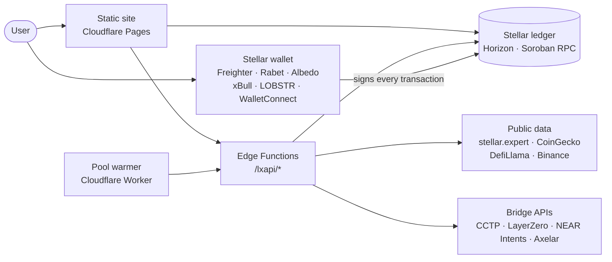

<div align="center">


# LumosCore

**Non-custodial trading, liquidity and cross-chain transfers on Stellar — and the shared edge layer behind every LumosCore network.**

[](https://lumoscore.com)
[](https://stellar.org)
[](https://pages.cloudflare.com)
[](LICENSE)

[**Open the app**](https://lumoscore.com) · [Trade](https://lumoscore.com/trade) · [Pools](https://lumoscore.com/pools) · [Bridge](https://lumoscore.com/bridge) · [Launchpad](https://lumoscore.com/launchpad) · [LUMOS token](https://lumoscore.com/lumos) · [MCP](https://lumoscore.com/mcp)

</div>

---

## Overview

### Finance should not be fenced in by networks

Value today lives on dozens of blockchains, and each one is its own walled garden: its own wallets, its own
exchanges, its own bridges, its own rules. Liquidity is scattered. Moving between networks means trusting a
middleman, juggling tools and hoping nothing breaks on the way. The more networks the world adopts, the worse
this gets.

**LumosCore is built to end that fragmentation.** One platform where anyone can issue an asset, trade it, provide
liquidity, earn rewards and move value across networks, with one experience everywhere and without ever giving up
control of their funds.

### Self-custody is not a feature. It is the foundation.

LumosCore never touches a user's keys. Every swap, order, deposit, launch and transfer is a transaction the user
signs in their own wallet. There are no accounts to create, no balances held on anyone's behalf and no withdrawal
queue to wait in. If LumosCore disappeared tomorrow, every user's assets would still be exactly where they are: in
their own wallets, or in the on-chain pools and order books they chose, withdrawable by them alone.

That is the line we will not cross on any network: **financial freedom means owning your money outright.**

### One platform, many networks

LumosCore is live on **Stellar**, the **XRP Ledger** and **NEAR Protocol**, all served from a single site, with more
networks on the way. A chain switcher moves between them. Each network keeps what makes it strong: its native
assets, its own exchange venues, its own wallets. LumosCore brings them together under one interface and one
standard of quality, with bridges between them built in.

### Why Stellar

Stellar puts the exchange **in the ledger itself**. Order books and liquidity pools are protocol primitives, not
contracts someone deployed — so a trade settles in the same three to five seconds as a payment, for a fraction of a
cent, with no contract risk underneath it. Path payments let one asset leave a wallet and a different one arrive,
routed across whatever order books and pools make the best price. Assets are first-class too: issuing one is a
ledger operation, and `stellar.toml` gives an issuer a verifiable identity tied to a real domain, which is what
makes a curated list of assets possible at all.

That combination is why LumosCore started here, and Stellar remains the parent build: **this repository holds the
Stellar application and the shared Cloudflare edge Functions that every LumosCore network calls.** 28 of the 83
Functions in here serve a build other than this one.

> **Your keys never leave your wallet.** Every action is a transaction you approve in your own Stellar wallet.
> LumosCore holds no keys, takes no custody and runs no account system.

## Features

| | |
|---|---|
| **Trade** | Asset pages with live price, charts, holders, pools and recent trades. Swaps routed over the Stellar SDEX through Horizon path-finding, plus limit orders on the on-chain order book. |
| **Pools** | Every Stellar AMM pool with liquidity, 24h volume and fees. Create a pool, add or withdraw liquidity, and browse the **Rewarded Pools** that earn LUMOS. |
| **Bridge** | Move assets off Stellar and back over **Circle CCTP**, **LayerZero / USDT0**, **NEAR Intents** and **Axelar ITS**, with each route's fees and timing shown up front, and claims handled in the app where a route needs one. |
| **Wallet** | Balances, send and receive, trustlines, LP positions, open orders (cancel, collect, claim) and a decoded activity history. |
| **Launchpad** | Issue and launch a Stellar asset end to end. |
| **Rewards** | The LUMOS Native LP, Ecosystem LP and Whale Holder programmes. |
| **Dashboard** | Network stats, trending assets, markets and live Platform Activity. |
| **Blog, FAQ, Account pages** | Posts served from the edge, per-section question sets rendered by one shared view, and public per-address pages. |
| **MCP** | A Model Context Protocol server exposing read-only and quote tools — see [`mcp/`](mcp/). |

**Supported wallets:** Freighter, Rabet, Albedo, xBull, LOBSTR and WalletConnect. No build ever receives a private
key — connecting returns an address, and signing happens inside the wallet.

## Architecture



- **Static site.** Every page is pre-built HTML with its data logic injected as layers, served from Cloudflare Pages.
- **Edge Functions.** A thin layer that caches public data, shields upstreams from rate limits and holds the keys an
  upstream requires. It never holds user funds or keys. The same layer serves the XRPL and NEAR builds.
- **Pool warmer.** A standalone Worker that keeps the pool ranking warm, because Pages Functions have no cron
  trigger and ranking every pool is too slow to do on a visitor's request.
- **Honest data.** Every figure is read live from the chain or a public source. There is no backend database and no
  server-side account system. A value that cannot be read is shown as unknown, never as zero.

## Data sources

| Source | Used for |
|---|---|
| Horizon (SDF, and LOBSTR's mirror as a fallback) | Balances, trustlines, order books, path-finding, AMM pools, trades, network stats |
| Soroban RPC | Smart-contract reads and contract-invocation pages |
| stellar.expert | Asset metadata, holder distribution, issuer history |
| `stellar.toml` (SEP-1) | Issuer identity, asset names and logos, from the issuer's own domain |
| CoinGecko | USD reference prices |
| Binance | Candles for assets with a listed market |
| DefiLlama | Cross-chain TVL context |
| CCTP, LayerZero, NEAR Intents, Axelar | Bridge quotes, transfer status, claims |

## Getting started

```bash
npm install
npm run serve      # http://localhost:8080
```

`dist/` is committed, so this works straight after cloning with no build step. `serve.js` deliberately mirrors
production: it reads the same `dist/_redirects` Cloudflare uses, applies the same legacy-URL redirects, and does the
same User-Agent device selection, so local behaviour matches the deployed site instead of drifting from it.

```bash
npx wrangler pages dev dist
```

`serve.js` is close to production but not identical — `.html` → extensionless 308s, `_routes.json` coverage and
Functions execution only appear under the real Cloudflare runtime. Test anything routing-related this way before
deploying.

### How the build works

This is not a typical framework app, and the layout makes more sense once you know why.

The design ships as a small number of very large HTML **container** files — one per device variant — each holding
every page of the site as a JSON blob. The build is a pipeline of small, **idempotent** transforms that rewrite
those containers in place, followed by an extraction step that splits them into one file per page.

```text
lumoscore-aptos-desktop.html          design containers (not in this repo — see below)
lumoscore-aptos-mobile.html
        |
        |  _tools/*.js   246 transforms: data layers, theming, SEO, routing, fixes
        v
_tools/extract_site.js                splits containers into pages, rewrites links,
        |                             emits _redirects / _headers / _routes.json / middleware
        v
dist/                                 the deployed site  (committed)
```

Each transform is small and re-runnable: running one twice produces the same output as running it once. That is what
makes it safe to replay the whole pipeline after changing any single step.

A transform writes the **containers**, not `dist/`. Reading `dist/` straight after running one shows the previous
build — rerun `extract_site.js` first.

```bash
npm run build      # containers -> dist/
npm run deploy     # pre-deploy gate, then a manual deploy
```

⚠️ **`npm run build` will not work from a fresh clone.** It reads the design containers (`lumoscore-aptos-*.html`,
about 337 MB), which are excluded from the repository because of their size. The committed `dist/` is the build
output, so you can read, run, host and modify the site without ever rebuilding.

`_tools/predeploy_check.js` blocks a deploy if it finds admin pages in the public build, anything resembling a
secret (API keys, Stellar seeds, AWS or GitHub tokens), oversized files, or a missing `index.html`.

### Deploying

Production is assembled from more than one network's build and uploaded directly with `wrangler pages deploy`, so
**a commit on `main` is not by itself proof of what is live.** Verify a release against the deployed URL, not
against the repository.

## Project structure

```text
_tools/          246 build transforms + extract_site.js + predeploy_check.js
_lib/            shared server-side helpers (admin auth, audit log, rate limiting, mail templates)
_data/           static build inputs — admin schema, OG card manifest, map asset
dist/            the built public site — this is what Cloudflare serves
functions/       Cloudflare Pages Functions (see below)
mcp/             the Model Context Protocol server
relayer/         CCTP relayer worker (currently parked, not in the delivery path)
cron-warm/       standalone Worker that keeps the pool ranking warm
_email-worker/   transactional mail worker
docs/            images for this README
serve.js         local server that mirrors production behaviour
LUMOSCORE_DEV.md development guide — read before changing anything
GUARDRAILS.md    hard rules for this codebase
WALLET_LOGIC.md  wallet page specification
```

### Cloudflare Functions

83 Functions in total, 28 of them serving a build other than this one. The main groups:

| Group | Purpose |
|---|---|
| `_middleware.js` | Clean-URL rewrites, legacy-filename 301s, device selection by User-Agent, edge SEO injection |
| `lxapi/` asset & market | Holder distribution, asset search and metadata, logos, prices, candles, movers, network stats |
| `lxapi/` bridge | Route quotes and transfer status for CCTP, LayerZero, NEAR Intents and Axelar |
| `lxapi/` launchpad & listing | Mint metadata, listing requests and their payment quotes |
| `lxapi/` blog | Post index and bodies, plus news. Live posts are public; drafts are not — see Security |
| `lxapi/` admin | Audit log, analytics and badge endpoints, reachable only from the private admin project |
| `lxapi/xrpl*`, `lxapi/near*` | The XRPL and NEAR builds' data endpoints — served from here because the edge layer is shared |
| `robots.txt.js`, `sitemap.xml.js`, `llms.txt.js` | Generated at the edge; the sitemap enumerates live assets and pools from the chain |
| `.well-known/*.toml.js` | SEP-1 `stellar.toml` and the XRPL equivalent |

`_middleware.js` and `_routes.json` are **generated** by `extract_site.js` from a single route table — don't
hand-edit them.

The convention for a `/lxapi/` endpoint is to answer **200 with an `ok: false` body** on failure rather than a 5xx,
because Cloudflare replaces a real 5xx body with its own error page and the client can no longer read why it failed.
41 of the 75 endpoints follow it; the rest predate the convention and are being migrated.

## What this repository deliberately does not contain

- **The admin panel.** It lives in a separate private repository and deploys as its own Cloudflare Pages project
  behind Cloudflare Access. Its protection is that its files are not on any public server. The `lxapi/admin*`
  Functions are here, but they authenticate against that project.
- **The design containers** (about 337 MB) and the wider source asset library — excluded for size. `dist/assets`
  holds everything the built site actually references.
- **The XRPL and NEAR front-ends.** Only their shared edge Functions live here; each has its own repository.
- **Any secret.** Every third-party key lives as a Cloudflare secret and is read server-side by the Function that
  needs it; the browser never receives a credential. There are no keys in the git history to find.

## Security

- **Non-custodial by design.** No code path can move funds; every write is a transaction the user signs in their own
  wallet. This holds for every surface, the LUMOS wallet view included.
- **No secrets in the repository.** API keys live as Cloudflare secrets (`wrangler secret put`) and `.env*` is
  ignored.
- **Hostile input handled as such.** Asset codes, issuer domains and token names are attacker-controlled — anyone
  can issue an asset and call it anything. They are escaped at every render site and never trusted for identity;
  verification comes from the curated list and the issuer's own `stellar.toml`.
- **`X-Frame-Options: DENY` site-wide.** This app triggers wallet signing prompts, and a framed signing flow is a
  clickjacking target.
- **Privileged requests need `requireAdmin()`, which is two conditions, not one.** The request must arrive on the
  admin hostname *and* carry a Cloudflare Access JWT that verifies against our team's keys. The hostname alone
  proves nothing, because `functions/` is shared across all three Pages projects — every endpoint in here also
  exists on `lumoscore.com`.
- **A post that is not live yet is not public.** "Live" means `published` **and** `publishAt` in the past, and that
  one test is applied in all three places a post can surface: the public API, the index, and the edge SEO injection
  on an article's own url. Two gaps were closed on 2026-11-13 — `lxapi/blog?all=1` honoured a request for drafts
  without checking who was asking, and the middleware's own lookup tested `published` while ignoring `publishAt`, so
  a scheduled post's headline and cover were injected at its direct url before its time. Asking for drafts without
  admin credentials now returns 403.
- **There is no Content-Security-Policy.** The design carries hundreds of inline scripts, so any workable policy
  would need `unsafe-inline` and would buy nothing. A real CSP requires extracting that inline code first.

Found a vulnerability? Please report it privately through [lumoscore.com/support](https://lumoscore.com/support)
rather than opening a public issue.

## Contributing

Read [`LUMOSCORE_DEV.md`](LUMOSCORE_DEV.md) and [`GUARDRAILS.md`](GUARDRAILS.md) first. They document the landmines
that have actually caused breakage here — competing icon painters, flash-of-unstyled-content gates, escaping levels
through template literals, and the transform ordering rules.

## Related repositories

| Network | Repository |
|---|---|
| Stellar (and the shared edge Functions) | **This repository** |
| NEAR | [RazaRizv1/lumoscore-near](https://github.com/RazaRizv1/lumoscore-near) |

## License

Released under the [MIT License](LICENSE).
